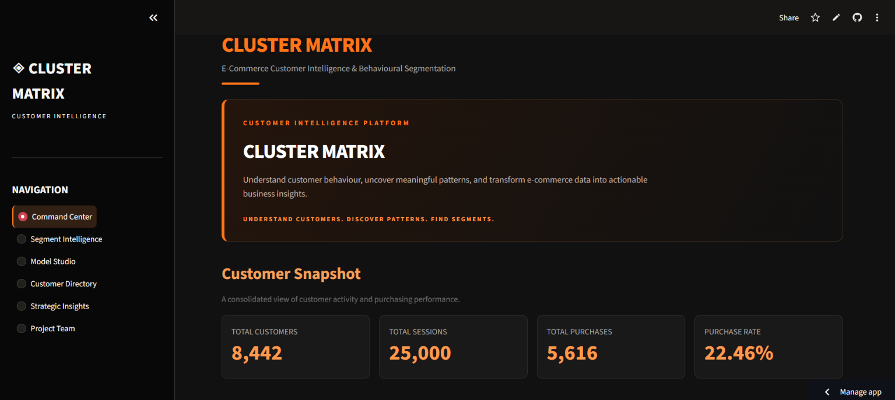

◈ Cluster Matrix

E-Commerce Customer Intelligence & Behavioural Segmentation
Understand customers. Discover patterns. Find segments.

Cluster Matrix is a machine learning and data analysis project focused on understanding customer behaviour in e-commerce.

Every customer interacts with an online store differently. Some visit more often, some spend more time exploring products, while others are more likely to make a purchase.

The aim of this project is to study these differences instead of treating all customers as one group. Using K-Means clustering, the project identifies customer segments based on their activity, engagement, and purchasing patterns.

It also includes an interactive Streamlit dashboard that makes the results easier to explore and helps connect the analysis with useful business insights.
Live Application
Cluster Matrix is deployed and ready to explore.

Launch Cluster Matrix → (https://cluster-matrix.streamlit.app/)

Explore customer segments, purchasing behaviour, model evaluation, customer profiles, and business insights through the interactive dashboard.

No local installation or setup is required to explore the live application.

Dashboard Preview

What This Project Does
- Analyses customer activity and purchasing patterns.
- Converts session-level records into customer-level data.
- Groups customers with similar behaviour using machine learning.
- Compares customer segments based on revenue and activity.
- Provides customer-level search and filtering through a dashboard.
- Presents findings and recommendations based on the analysis.
Dataset
Detail	Information
Dataset	Indian E-Commerce Customer Behavior & Purchase
Creator	Kundan Bedmutha
Source	Kaggle Dataset
Records	25,000 session records
Columns	29

The dataset contains simulated e-commerce interaction records, including customer sessions, purchases, revenue, pages viewed, time spent on the website, cart activity, devices, and marketing channels.

For this project, the session records are grouped using customer IDs to create a customer-level summary.

Dataset credit: Kundan Bedmutha. Please refer to the original Kaggle page for the creator's usage terms.

The original CSV file is not included in this repository. It was used during data analysis and model development. The deployed dashboard uses the processed customer segmentation results, so downloading the original dataset is not required to explore the live application.
How the Project Works
The project follows a series of steps, starting with data exploration and ending with customer segmentation and dashboard development.

1. Data Exploration
I first inspected the dataset to understand its structure, columns, data types, missing values, duplicate records, and general customer activity.

2. Customer-Level Aggregation
The original dataset contains individual customer sessions. I grouped these records using customer_id to calculate overall activity for each customer.

This produced a customer-level dataset with information such as total sessions, purchases, revenue, average pages viewed, average time on site, and cart activity.

3. Feature Selection
Five features were selected for the clustering process:
- Total sessions
- Total revenue
- Average pages viewed
- Average time on site
- Total cart additions
These features were selected to represent different aspects of customer activity and purchasing behaviour.

4. Feature Scaling
I used StandardScaler from Scikit-learn to standardise the selected features before clustering.

This was important because the features have different ranges and units.

5. Customer Clustering
I applied the K-Means algorithm and used three clusters for the final segmentation.

The model was trained with a random state of 42 and 10 initialisations.

6. Model Evaluation
Different cluster configurations were compared using:
- Elbow Method
- Silhouette Score
- Davies-Bouldin Index
I also compared K-Means with Agglomerative Clustering to get a better understanding of the segmentation results.
Customer Segments
The final K-Means model divides 8,442 customers into three segments.
Cluster	Customer Segment	Customers
0	Engaged Browsers	2,855
1	High-Value Customers	2,644
2	Quick Browsers	2,943

Understanding the Segments
Cluster 0: Engaged Browsers

These customers spend more time on the website on average, but generate comparatively lower revenue.

Cluster 1: High-Value Customers

This group has higher average revenue, more sessions, and more cart additions compared with the other segments.

Cluster 2: Quick Browsers

These customers spend less time on the website on average and generate comparatively lower revenue.

The segment names are based on the average characteristics of each cluster. They are interpretations of the data, not fixed descriptions of every customer.

Model Results

The final dashboard uses the following K-Means configuration:
Setting	Value
Algorithm	K-Means
Number of clusters	3
Silhouette Score	0.2070
Davies-Bouldin Index	1.5456
Random State	42
Initialisations	10
Customers clustered	8,442

Three clusters were selected mainly because they provide a reasonably balanced and understandable segmentation.

Although other cluster configurations performed better on individual evaluation metrics, the final choice also considered how easily the segments could be interpreted.
The Dashboard
The project includes an interactive dashboard developed using Streamlit.

It has six main sections:
Section	Purpose
Command Center	Customer snapshot and revenue performance
Segment Intelligence	Customer segments and behavioural profiles
Model Studio	Model configuration and evaluation results
Customer Directory	Customer search, filters, and individual profiles
Strategic Insights	Key findings and business recommendations
Project Team	Team members and project contributions

The dashboard brings the analysis together in one place, making it easier to explore customer segments, compare their characteristics, and understand the results.

Tech Stack

- Python: Main programming language
- Pandas: Data processing and analysis
- Scikit-learn: Feature scaling and machine learning
- Streamlit: Interactive dashboard development
- Plotly: Interactive charts
- Matplotlib: Data visualisation
- Joblib: Saving and loading trained models

Project Structure

Cluster-Matrix/
├── app.py
├── assets/
│   └── dashboard_preview.png
├── data_analysis/
│   ├── agglomerative_comparison.py
│   ├── customer_aggregation.py
│   ├── exploratory_analysis.py
│   ├── model_evaluation.py
│   └── model_validation.py
├── models/
│   ├── kmeans_model.pkl
│   └── scaler.pkl
├── outputs/
│   ├── graphs/
│   └── results/
├── src/
│   ├── data_processing.py
│   └── train_model.py
├── .gitignore
├── README.md
└── requirements.txt

Limitations

- The dataset contains simulated customer interactions.
- Cluster names are interpretations based on average values, not confirmed customer categories.
- Three clusters were selected with interpretability in mind, rather than being the best option across every evaluation metric.
- The results may vary when the model is applied to a different dataset.

Project Team

Arisha Khanam -
Data Analysis & Machine Learning

Alveera Haidari -
Dashboard Development & Business Intelligence

Integral University
B.Tech, Computer Science and Engineering
(Data Science & Artificial Intelligence)
Academic Year: 2026–2027

Built as an academic project to explore customer behaviour through data analysis, machine learning, and visualisation.

◈ Cluster Matrix
Understand customers. Discover patterns. Find segments.